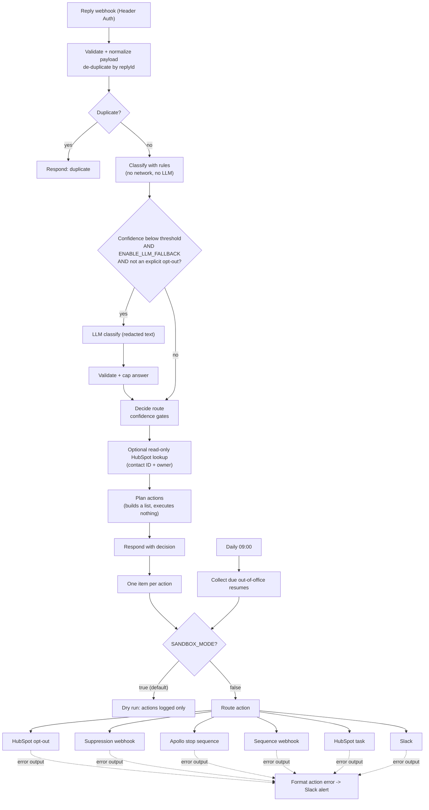

# Outbound Reply Triage Router

**An n8n workflow that classifies replies to outbound sequences and routes each one to the right action — with deterministic rules first, an optional LLM fallback, a human-review queue for anything uncertain, and a sandbox gate that is closed by default.**


---

## 1. Overview & business value

Every reply to a cold sequence needs a different response, and the cost of getting it wrong is lopsided:

- **An opt-out that keeps getting emails** drives spam complaints, hurts sender reputation, and creates legal exposure.
- **A hot reply that sits in a shared inbox** is a lost meeting.
- **An out-of-office auto-reply** wrongly treated as a human response (or ignored while the sequence keeps firing) wastes touches.
- **"Wrong person" replies** contain free referrals that usually get lost.

This router takes each reply and decides what to do, so humans only see what needs a human.

| Reply | What the router does |
|---|---|
| **Unsubscribe** | Suppresses the contact (HubSpot opt-out and/or your suppression webhook), stops the sequence. Always alerts a human if no suppression target is configured. |
| **Interested** | Stops the sequence, creates a HIGH-priority CRM task, alerts the owner in Slack. |
| **Out of Office** | Pauses the sequence, parses the return date, queues a delayed re-enrollment. |
| **Wrong Person** | Stops the sequence, extracts the referred contact (name / title / email), creates an enrichment task. |
| **Not Now** | Stops the sequence, creates a follow-up task due after the wait the lead asked for. |
| **Not Interested** | Stops the sequence only (a "no" is not an opt-out). |
| **Anything uncertain** | **Human-review queue** (Slack + CRM task). Never a guess. |

### Deliverability & compliance impact (what it does and does not do)

- Faster, consistent handling of opt-outs and no-longer-interested replies means fewer follow-up emails to people who asked you to stop — which is what protects reputation. The deterministic rules are explainable, so you can show *why* a reply was suppressed.
- **It does not make you compliant.** Legal duties around opt-outs (e.g., CAN-SPAM, CASL, GDPR) depend on your setup and jurisdiction, and the router only acts on what you configure. You must verify opt-outs are honored in **every** system that can send to that person. See the [disclaimer](#️-disclaimer--liability-limitation).

### Why rules first, LLM optional

Regex/rule classification is predictable, free, offline, auditable, and has no data-processing implications. That matters most for the highest-stakes class (opt-outs), so an explicit opt-out is **never** routed through, or overridden by, an LLM. The optional fallback only helps with replies the rules cannot place, and is **off** unless you set `ENABLE_LLM_FALLBACK=true`.

## 2. Architecture



```
 reply ──► normalize ──► dedupe ──► RULES ──► (LLM?) ──► decide ──► lookup ──► plan ──► respond
                                                                                     │
                                                                          SANDBOX GATE (closed by default)
                                                                       ┌─────────────┴──────────────┐
                                                                  dry-run log                   executors ──error──► Slack alert
```

Two workflows ship in `workflows/`:

| File | Purpose |
|---|---|
| `01-reply-triage-router.json` | The router (webhook + daily out-of-office resume check). Sticky notes document each block. |
| `02-error-handler.json` | Set as the router's *Error Workflow* to alert on failures outside the executors. |

## 3. Classification logic & routing matrix

Each label is scored by the rules that match (noisy-OR of rule weights). The top score becomes the **confidence**, reduced when a competing label also scores well, so mixed signals drop below the threshold and go to review. Details and tuning guide: [docs/CLASSIFICATION.md](docs/CLASSIFICATION.md).

Key behaviors (all covered by tests):

- **Explicit opt-outs win** over every other signal ("not interested, please unsubscribe me" → UNSUBSCRIBE) and are honored at the lower `UNSUBSCRIBE_CONFIDENCE_THRESHOLD` (0.60) — suppressing is the safe direction.
- **Quoted history is ignored** (`On … wrote:`, `> quoted`, forwarded headers) so your own pitch can't be mistaken for the reply.
- **"Not interested" is never read as INTERESTED**; "interested, but not right now" is NOT_NOW.
- **Auto-reply headers** (`Auto-Submitted`, `X-Autoreply`, `Precedence: auto_reply`) mark out-of-office.
- **Bounces** (mailer-daemon, delivery failures) are ignored — handle them in your sending tool.

| Route | Condition | Sequence | CRM | Slack | Other |
|---|---|---|---|---|---|
| `UNSUBSCRIBE` | explicit opt-out, conf ≥ 0.60 | stop | `hs_email_optout=true` (if `HUBSPOT_ENABLED`) | only if `NOTIFY_ON_UNSUBSCRIBE`, **or always if no suppression target is configured** | POST to `SUPPRESSION_WEBHOOK_URL` |
| `INTERESTED` | conf ≥ 0.80 | stop | HIGH task due in `INTERESTED_TASK_DUE_HOURS` | alert + owner @mention | — |
| `OUT_OF_OFFICE` | conf ≥ 0.80 | pause until return date | — | — | queue resume at return date + `OOO_REENROLL_DELAY_DAYS` (or `OOO_DEFAULT_PAUSE_DAYS`) |
| `WRONG_PERSON` | conf ≥ 0.80 | stop | enrichment task with extracted referral | info (referred email masked) | referral is best-effort: verify |
| `NOT_NOW` | conf ≥ 0.80 | stop | follow-up task after the requested wait (default `NOT_NOW_FOLLOWUP_DAYS`) | only if `NOTIFY_ON_NOT_NOW` | — |
| `NOT_INTERESTED` | conf ≥ 0.80 | stop | — | — | not an opt-out |
| `REVIEW` | conf < 0.80, mixed signals, or no rule matched | hold if `PAUSE_ON_REVIEW` | review task if `REVIEW_CREATE_TASK` | review alert | **human decides** |
| `BOUNCE` | system sender | — | — | — | ignored |

"Sequence" actions run only if `SEQUENCE_PROVIDER` is `apollo` or `webhook` (default `none`). Apollo's default mode is `stop` (halts steps, keeps context); `remove` is permanent.

### How accurate are the rules? (honest numbers)

`npm run eval` scores the rules against hand-written, synthetic, English-only samples:

| Set | Size | Routed as expected | Wrong action | Fell to human review |
|---|---|---|---|---|
| Tuning set | 116 | 100% (rules were tuned on it) | 0 | 0 |
| **Fresh hold-out** (never tuned on) | 30 | **73%** | **0** | 8 |

On unseen phrasing, roughly a quarter of replies went to the human queue **instead of triggering a wrong action** — that is the designed failure mode. A first hold-out scored 58% and drove a round of rule generalization; those examples were then moved into the tuning set and a fresh hold-out was written. These samples were written by the repo author, so they are a regression guard, **not** a production accuracy claim. Sample your own replies, add them to `sample-data/labeled-replies.json`, and tune. If review volume is too high, the optional LLM fallback is the intended way to reduce it.

## 4. Prerequisites, environment variables & credentials

**You need:** n8n (self-hosted recommended; `N8N_BLOCK_ENV_ACCESS_IN_NODE=false` so Code nodes can read env vars), and something that can POST each reply to the webhook (see below). Everything else is optional and off by default. Node.js ≥ 18 is only needed to run the local tests/demo.

**Where replies come from.** This repo does **not** pull replies out of Apollo, HubSpot, or your mailbox. Point a webhook, automation, or another n8n workflow at the *Reply Webhook* with the payload in [`schemas/reply-payload.schema.json`](schemas/reply-payload.schema.json). The workflow also accepts tolerant aliases for Apollo-style and HubSpot-style field names (see `docs/sample-payloads/09-*` and `10-*`), but those adapters are best-effort and **unverified against your account** — if your tool's fields differ, map them to the generic shape.

**Credentials** (map the placeholders on import; no real credentials or IDs are in the JSON):

| Placeholder | n8n credential type | Used by |
|---|---|---|
| `YOUR_WEBHOOK_AUTH_CREDENTIAL` | Header Auth (e.g. header `X-Webhook-Secret` + a long random value) | *Reply Webhook* — required |
| `YOUR_HUBSPOT_CREDENTIAL` | HubSpot App Token | contact lookup (read), task creation + opt-out (write). Start read-only; HubSpot error messages name any missing scope |
| `YOUR_APOLLO_CREDENTIAL` | Header Auth (Apollo API key header) | *Apollo: Stop Sequence*, only if `SEQUENCE_PROVIDER=apollo` |
| `YOUR_LLM_CREDENTIAL` | Header Auth (e.g. `Authorization: Bearer …`) | *LLM Classify*, only if `ENABLE_LLM_FALLBACK=true` |

**Environment variables** (full commented list in [`.env.example`](.env.example)):

| Variable | Default | Purpose |
|---|---|---|
| `SANDBOX_MODE` | `true` | Dry-run gate. Only `false/0/no/off` disable it; typos keep it **on** |
| `CONFIDENCE_THRESHOLD` | `0.80` | Below this → human review |
| `UNSUBSCRIBE_CONFIDENCE_THRESHOLD` | `0.60` | Lower on purpose for explicit opt-outs |
| `ENABLE_LLM_FALLBACK` | `false` | Optional LLM for sub-threshold replies (needs `LLM_API_URL`, `LLM_MODEL`) |
| `SEQUENCE_PROVIDER` | `none` | `none` / `apollo` / `webhook` |
| `HUBSPOT_ENABLED` | `false` | Contact lookup, tasks, opt-out |
| `SLACK_WEBHOOK_URL`, `SUPPRESSION_WEBHOOK_URL`, `SEQUENCE_WEBHOOK_URL`, `LLM_API_URL` | empty | Secrets: read only by the HTTP nodes, never copied into execution data |

## 5. Deployment & sandbox testing guide

Full walkthrough with troubleshooting: [docs/SETUP.md](docs/SETUP.md). The short version:

**A. Try it offline (no accounts, no n8n):**

```bash
git clone https://github.com/dhrobinsystems/outbound-reply-triage-router.git
cd outbound-reply-triage-router
npm test        # 94 checks, including the real generated Code-node code run on sample payloads
npm run demo    # routes all 13 sample payloads in sandbox and prints the planned actions
npm run eval    # classifier accuracy on the labeled samples
```

```
payload                           route           conf   planned actions (not executed)
01-interested                     INTERESTED      0.984  SLACK
02-not-now                        NOT_NOW         0.991  -
03-wrong-person                   WRONG_PERSON    0.964  SLACK
04-out-of-office                  OUT_OF_OFFICE   0.96   -
05-unsubscribe                    UNSUBSCRIBE     0.996  SLACK            <- "no suppression target configured" alert
06-not-interested                 NOT_INTERESTED  0.984  -
07-review-ambiguous               REVIEW          0      SLACK
11-bounce                         BOUNCE          0.95   -
```
(`npm run demo -- --live-plan` shows the fuller plan with Apollo + HubSpot + Slack configured — still nothing is sent.)

**B. Deploy to n8n in sandbox mode:**

1. Set env vars from `.env.example` on your n8n instance. **Keep `SANDBOX_MODE=true`.**
2. Import both files in `workflows/`. Create the credentials above and map the `YOUR_*_CREDENTIAL` placeholders.
3. In *Workflow settings* of the router, set **Error Workflow** to *Reply Triage - Error Handler*.
4. Open the router, click **Listen for test event** on *Reply Webhook*, then send a sample:

   ```bash
   export WEBHOOK_URL="https://YOUR-N8N-HOST/webhook-test/reply-triage"
   export WEBHOOK_SECRET="your header-auth value"
   export WEBHOOK_HEADER="X-Webhook-Secret"
   ./scripts/send-sample.sh docs/sample-payloads/01-interested.json
   ```

   The response contains the label, confidence, route, and `plannedActions`. In the editor, the **Dry Run: Actions Logged** node shows exactly what *would* have been sent. Nothing is written, paused, or posted.
5. Send every file in `docs/sample-payloads/` (one per branch) and compare with the table above.
6. Replay a sample of **your own** historical replies in sandbox, review the REVIEW rate, and tune (`docs/CLASSIFICATION.md`).

**C. Going live — only after step 6:** enable one capability at a time (e.g. Slack alerts first, then tasks, then sequence control, then suppression), set `SANDBOX_MODE=false`, activate the workflow, and watch the first executions. Keep a human reviewing the REVIEW queue.

## Sample payloads

`docs/sample-payloads/` has one payload per branch (interested, not now, wrong person, out of office with auto-reply header, unsubscribe, not interested, two review cases, Apollo-style, HubSpot-style, bounce, a prompt-injection-style reply, and an HTML reply with quoted history). The schema is in `schemas/`. All data is fictional (`example.com`, `acme.example`).

## Safety & privacy notes

- **Sandbox first:** the gate sits in front of *every* executor; a test asserts the executors are unreachable except through the gate's "live" output.
- **Secrets stay out of data:** webhook URLs are read from env by the HTTP nodes only; the config object holds booleans, so URLs never appear in execution data. Workflow JSON is sanitized (no credential IDs, `webhookId`s, instance IDs); CI fails if that regresses.
- **PII minimization:** Slack shows masked emails and a short excerpt (`SLACK_INCLUDE_EXCERPT=false` removes it); error alerts never include reply content; LLM input is redacted and truncated.
- **Prompt injection:** reply text is untrusted. Rules only match phrases and cannot be "instructed", but they *can* be matched — a reply that literally says "I'm interested" is treated as interested, and a human sees the resulting task/alert. With the LLM fallback on, the model's answer is validated against an allow-list and capped, and it can never override an explicit opt-out. Residual risk remains; keep LLM-driven actions low-impact.
- **Retries:** duplicate webhook deliveries are de-duplicated by `replyId` (live mode). CRM task creation is not auto-retried, to avoid duplicate tasks.

## Known limitations

- English-only rules. Non-English replies will mostly land in REVIEW.
- Accuracy numbers come from small synthetic samples (see above).
- State (de-duplication, out-of-office resume queue) lives in n8n *workflow static data*: saved only for active production executions, per instance, not transactional, and not a database.
- Apollo/HubSpot payload adapters, the Apollo stop-sequence call, and HubSpot task/opt-out calls are written from documentation and **have not been run against live accounts**. Verify in sandbox, then with a single test contact.
- Sequence *resume* is only automated through your own webhook; for Apollo/HubSpot-only setups the daily check creates a re-enroll reminder (task or Slack).
- Slack incoming webhooks cannot carry interactive buttons, so the review queue is read-and-act, not click-to-approve.
- No pagination, batching, or rate-limit shaping beyond n8n's retry settings.

## Roadmap ideas

Slack interactivity (approve / override a classification), feedback loop that turns overrides into labeled samples, more languages, a durable queue (database) instead of static data, per-sequence thresholds.

## Repository layout

```
├── workflows/                 # import into n8n (generated - do not edit by hand)
│   ├── 01-reply-triage-router.json
│   └── 02-error-handler.json
├── src/                       # tested, dependency-free logic inlined into the Code nodes
│   ├── rules.js  classifier.js  extractors.js  normalize.js  router.js
│   ├── llm.js  slack-blocks.js  config.js  text.js
├── scripts/                   # build-workflows.js, demo.js, eval.js, send-sample.sh, node-code/ (n8n glue)
├── tests/                     # 94 checks + n8n Code-node simulation harness
├── docs/                      # SETUP.md, CLASSIFICATION.md, sample-payloads/ (one per branch)
├── schemas/reply-payload.schema.json
├── sample-data/               # labeled-replies.json (tuning) + holdout-replies.json (never tuned on)
├── .env.example  .gitignore  LICENSE  DISCLAIMER.md  CONTRIBUTING.md  CHANGELOG.md
```

## Contributing

See [CONTRIBUTING.md](CONTRIBUTING.md). Edit `src/` and `scripts/node-code/`, then run `npm run build`; the JSON in `workflows/` is generated.

---

## ⚠️ Disclaimer & Liability Limitation

**Use at your own risk.** The code, workflows, and scripts provided in this repository (`outbound-reply-triage-router`) are for educational and architectural demonstration purposes.

* **No Liability:** The author and dhRobin Systems assume no responsibility or liability for any direct, indirect, incidental, or consequential damages resulting from the use, misuse, or deployment of these scripts and workflows.
* **Reply Classification, Suppression & Sequence-Control Risks:** Automated reply handling carries inherent risks. Rule-based and (optional) LLM classification will sometimes be wrong: a genuine opt-out can be missed or routed to human review late, a positive reply can be mislabeled, and a lead can be suppressed, paused, or stopped by mistake. When `SANDBOX_MODE=false`, these workflows can **write** to external systems: they can set HubSpot's `hs_email_optout` on a contact (effectively irreversible through the API), create HubSpot tasks, stop or — if you configure `APOLLO_STOP_MODE=remove` — permanently remove contacts from Apollo sequences, call your own suppression and sequence-control webhooks, and post to Slack. Misconfigured thresholds, incorrect property mappings, wrong IDs, bad API calls, duplicate deliveries, or aggressive retries can suppress or pause the wrong people, lose leads, create duplicate tasks, flood Slack channels, exhaust API rate limits, or leave a real opt-out unhonored. Optional LLM fallback sends redacted reply text to the third-party endpoint you configure.
* **User Responsibility:** You are solely responsible for compliance with applicable laws, regulations, and contracts, including data-protection and privacy rules (such as GDPR, CCPA, and CASL), anti-spam rules (such as CAN-SPAM), API rate limits, and the terms of service of HubSpot, Apollo, Slack, n8n, your LLM provider, and any other provider you connect. Using this project does not make your outbound program compliant. You are also solely responsible for proper testing (`SANDBOX_MODE=true`) before connecting any scripts to production environments, live CRM data, live sequences, or live notification channels.

Full text: [DISCLAIMER.md](DISCLAIMER.md) · Licensed under the [MIT License](LICENSE).

## License

[MIT](LICENSE) © 2026 dhRobin Systems · Provided as-is, see the [disclaimer](#️-disclaimer--liability-limitation).
